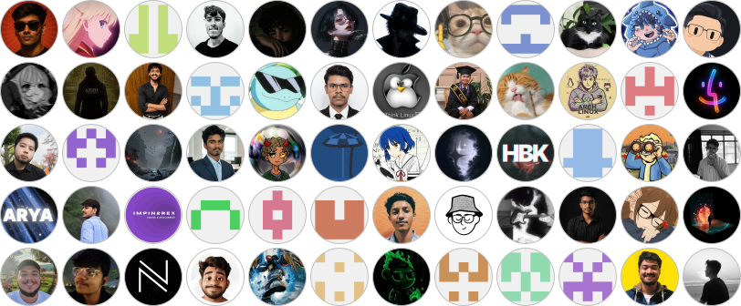

 
 

# BitChord

### Aesthetic YouTube Music Client for Android, Desktop & Terminal

 

 

[**Download & Platforms**](#download) · [**Features**](#features) · [**CLI Player**](CLI.md) · [**Desktop App**](DESKTOP.md) · [**Contributing**](#contributing) · [**Disclaimer**](#disclaimer)

 

> [!IMPORTANT]
> BitChord is not affiliated with, endorsed by, or connected to YouTube or Google in any way. Use it at your own discretion.

---

<h1>Features</h1>

<table>
  <tr>
    <td width="50%" valign="top">

#### Playback
- **Search, browse and play** anything available on YouTube Music.
- **Hi-Res lossless audio** — FLAC/ALAC from a configured module source, with YouTube Music as fallback.
- **Gapless playback with true crossfade**, adjustable 0–12s.
- **Automix [Beta]** — DJ-style transitions with beat-matching and tempo-stretching.
- **Offline downloads** — save tracks with embedded metadata.
- **Local music library** integration.
- **Background playback** via a proper foreground media session.
- **Apple-like lyrics animation** — credit to [binimum](https://github.com/binimum/am-lyrics).

#### Connectivity & Accounts
- **Sign in with your Google account** for personalized content.
- **Spotify integration** — connect your account to play your playlists and Liked Songs.
- **Discord Rich Presence** — in-app login, live track/artist/album and progress.
- **Scrobbling** to Last.fm and ListenBrainz.
- **Pluggable sources** — add, edit, test and health-check module sources.

    </td>
    <td width="50%" valign="top">

#### Experience & Platforms
- **Android, Desktop & CLI** — phone, tablet, Android TV, Wear OS watch remote, Desktop (Linux, macOS, Windows), and ultra-lightweight Terminal/CLI.
- **Animated album canvas** — motion artwork on the now-playing screen.
- **Word-synced lyrics** — word/syllable-level highlighting from multiple sources.
- **Lyrics providers** — credit to [lrc.red](https://lrc.red), [BiniLyrics](https://github.com/binimum), [BetterLyrics](https://github.com/better-lyrics/better-lyrics), [PaxSenix](https://lyrics.paxsenix.org), [LyricsPlus](https://github.com/ibratabian17/YouLyPlus), [SimpMusic](https://github.com/maxrave-dev/SimpMusic), [Unison](https://unison.boidu.dev), [Megalobiz](https://www.megalobiz.com), [KuGou](https://www.kugou.com), [LRCLIB](https://lrclib.net), [Musixmatch](https://www.musixmatch.com) and [Genius](https://genius.com).
- **Dynamic, artwork-driven theming** — Material palette extracted from album art.
- **Liquid Glass UI** — frosted glass backdrop with ambient aurora mesh gradients and specular hairline borders.

#### Controls & Tweaks
- **Potato & Performance Glass mode** — hardware-accelerated downsampled blur delivering 100% of the frosted liquid glass aesthetic with >93% lower GPU fill rate on low-end laptops.
- **Per-network audio quality** — separate quality ceilings for Wi-Fi and mobile data.
- **Playback speed control** (0.5×–2.0×) and **skip silence**.
- **Sleep timer** — fixed presets or "stop after this track".
- **System equalizer** integration.
- **Bit-perfect USB exclusive output** — sends lossless tracks to a USB DAC unchanged, at each track's own rate and bit depth. Thanks to [Mornye](https://github.com/mornyeapp/Mornye) for the reference.
- **Stats for nerds** — codec, bit depth, sample rate, and more on the now-playing screen.

    </td>
  </tr>
</table>

---

<h1>Download & Platforms</h1>

<table>
  <tr>
    <td align="center" width="33%">
      <h3>📱 Android</h3>
      
Phone, Tablet, Android TV, Wear OS

      
        
      
Grab the latest signed APKs from <a href="https://github.com/DynamisOp/Bitchord/releases">Releases</a>.

    </td>
    <td align="center" width="33%">
      <h3>💻 Desktop</h3>
      
Linux (Arch/Deb/RPM/AppImage), macOS, Windows

      
Frosted liquid glass UI, low-resource potato mode, and ambient backdrop lighting.

       
      <a href="DESKTOP.md"><strong>Desktop Guide & Arch Package &rarr;</strong></a>
    </td>
    <td align="center" width="33%">
      <h3>⌨️ CLI / TUI</h3>
      
Terminal Player for Linux & macOS

      
Ultra-low resource usage, synced lyrics, 12-band ASCII audio spectrum visualizer, and playlist playback.

       
      <a href="CLI.md"><strong>CLI Guide & Keybindings &rarr;</strong></a>
    </td>
  </tr>
</table>

---

<h1>Contributing</h1>

We welcome contributions to BitChord! Please review our [Contributing Guide](CONTRIBUTING.md) and [Code of Conduct](CODE_OF_CONDUCT.md) before submitting a Pull Request.

[**Contributing Guide**](CONTRIBUTING.md) · [**Code of Conduct**](CODE_OF_CONDUCT.md) · [**Maintainers**](MAINTAINERS.md) · [**Additional Docs**](ADDITIONAL.md)

### Contributors ❤

---

<h1>Disclaimer & Legal Notice</h1>

BitChord is an independent, community-driven third-party audio player and client. It is **not** associated with Google LLC, YouTube Music, Deezer, Telegram, or any of their parent companies.

* **No Media Hosting:** BitChord does not host, upload, or store copyrighted music files. It operates strictly as an interface to scan local device storage or stream media directly from public, public-facing, or user-authenticated APIs.
* **Fair Use & API Usage:** This software is created solely for personal research, educational, and fair-use purposes. The user is entirely responsible for ensuring their usage aligns with their local copyright laws and YouTube Terms of Service.
* **No Ad-Blocking Guarantee:** While BitChord focuses on providing a clean listening environment, it does not guarantee permanent bypasses or modifications to commercial third-party platform conditions.
* **Copyleft:** BitChord is free software under the GPLv3. The license does not let anyone forbid others from selling or redistributing copies, but any distribution must come with the Corresponding Source under the same license.

---

<h1>License</h1>

This project is licensed under the **GNU General Public License v3.0 (GPLv3)**. See the [LICENSE](LICENSE) file for details.

